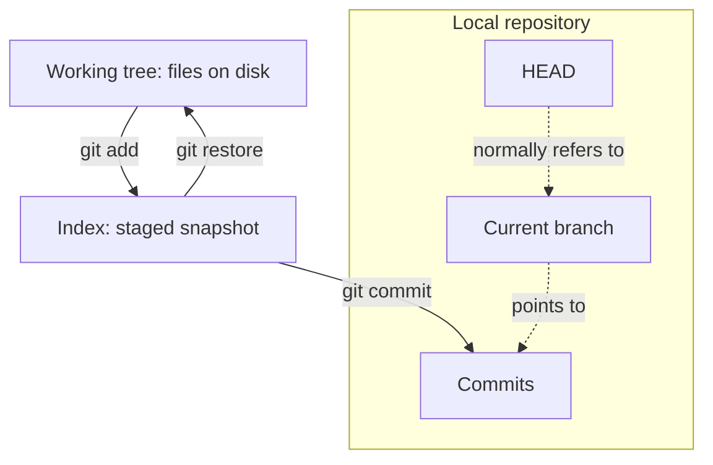
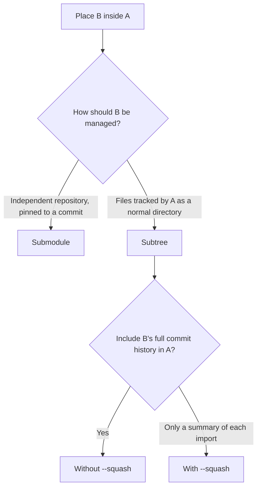

## Introduction

Agents write all the code, but I still make the Git commits. That's my last remaining contribution. (T_T)

Treat this as a Git quick reference, though it could also serve as a tutorial.

The official [cheat sheet](https://git-scm.com/cheat-sheet) is much better than mine.

### Working tree, index, and HEAD



- **Working tree:** the files you edit on disk.
- **Index (staging area):** the snapshot prepared for the next commit.
- **Local repository:** stored objects, including commits, and references such as branches.
- **HEAD:** normally refers to the current branch, which points to a commit. With a detached HEAD, it points directly to a commit.

## Lazygit

I recommend [Lazygit](https://github.com/jesseduffield/lazygit), a terminal user interface (TUI) for convenient Git operations.

## Configuration

### Inspect global configuration

```bash
git config --global --list
```

### Edit the configuration file

Open the global configuration file in Git's editor:

```bash
git config --global --edit
```

The file is usually `~/.gitconfig`; Git also supports `~/.config/git/config`. Add or update the relevant sections without replacing unrelated settings:

```gitconfig
[user]
    name = Your Name
    email = you@example.com
[core]
    editor = vim
```

Replace `vim` with your preferred installed editor. 

### Configure GitHub credentials with GitHub CLI

Install [GitHub CLI](https://cli.github.com/) (`gh`) if needed. With Homebrew:

```bash
brew install gh
```

Authenticate through the browser and configure Git's HTTPS credential helper:

```bash
gh auth login
gh auth setup-git
gh auth status
```

## Create or obtain a repository

### Clone a repository

Common remote cloning methods are HTTPS and SSH.

```bash
# HTTPS
git clone https://github.com/<username>/<repo_name>.git

# SSH, needs a configured SSH key
git clone git@github.com:<username>/<repo_name>.git
```

Pick either one. The SSH form only works when the host already knows your public key.

For SSH key creation, see [my SSH notes](https://squarezhong.github.io/posts/2026-04-10-ssh-notes/#ssh-keygen).

### Initialize a repository

```bash
git init -b main
```

## Commits and recovery

### Commit changes

```bash
git commit -a -m "Stylize the nav bar"
```

`-a` stages modifications and deletions of tracked files. New files still need `git add` before they can be committed.

### Compare commits

```bash
# the latest commit against its parent
git diff HEAD^ HEAD
```

`HEAD^` is the first parent. A root commit has no parent; for a merge commit, this compares against its first parent.

You can also compare two commits by their commit hashes (commit IDs):

```bash
# list abbreviated commit hashes
# press q to exit the pager
git log --oneline

# show the changes from the older snapshot to the newer one
git diff <older_commit> <newer_commit>
```

Use either full hashes or abbreviations that uniquely identify the commits in this repository. Reversing the arguments reverses the diff direction.

Reference: [git-diff](https://git-scm.com/docs/git-diff)

### Modify commits

Rewriting published commits changes their IDs and may disrupt collaborators. Please use with caution.

#### Amend the latest commit

```bash
git commit --amend
```

Optional parameters:

- `--no-edit`: keep the existing commit message without opening an editor.
- `-m "New message"`: replace the commit message directly, without opening an editor.
- `--date="Wed Dec 18 14:46 2024 +0800"`: set the author date, not the committer date.

Staged changes go into the replacement commit. Without `-m` or `--no-edit`, Git opens an editor for the message.

Reference: [git-commit](https://git-scm.com/docs/git-commit)

#### Modify earlier commits

Start with a clean working tree and index.

```bash
# list all commits
git log

# include the target commit and its descendants
# For the root commit, use `git rebase -i --root` instead, since it has no parent.
git rebase -i <commit>^
```

Git will open a list of commits.

**Change the message:** replace `pick` with `reword` on the target line. Save and close the rebase list; Git opens an editor for the new message and continues when it is saved and closed.

**Change the author date:** replace `pick` with `edit` on the target line. Save and close the list. When Git stops at that commit, run:

```bash
git commit --amend --date="Wed Dec 18 14:46 2024 +0800" --no-edit
git rebase --continue
```

`git rebase --abort` cancels an in-progress rebase and returns the branch to its original state.

Reference: [git-rebase](https://git-scm.com/docs/git-rebase), [git-commit](https://git-scm.com/docs/git-commit)

#### Force push

```bash
git push --force-with-lease origin <branch_name>
```

`--force-with-lease` compares the remote with the expected state before replacing it, but the remote history is still overwritten.

### Restore uncommitted deletions

File deleted in the working tree, deletion not yet staged — restore it from the index:

```bash
git checkout -- <file_name>
```

`git rm` was run but the deletion is not committed — unstage the deletion first:

```bash
git reset HEAD -- index.html
git checkout -- index.html
```

Both cases overwrite whatever is at that path in the working tree. If the deletion is already committed, take the file from a commit that still contains it:

```bash
git checkout <commit> -- <file_name>
```

### Reset the current branch

`git reset <commit>` moves the current branch to `<commit>`. The mode decides what happens to the index and the working tree.

| Mode | Index | Working tree |
| --- | --- | --- |
| `--soft` | kept | kept |
| `--mixed` (default) | reset to the target commit | kept |
| `--hard` | reset to the target commit | reset to the target commit |

Example:

```bash
# drop the latest commit together with its changes
git reset --hard HEAD^
```

### Move recent commits to a new branch

[Move the most recent commit(s) to a new branch with Git](https://stackoverflow.com/questions/1628563/move-the-most-recent-commits-to-a-new-branch-with-git)

## Branch

A branch is a movable reference to a commit. Its history consists of the commits reachable through parent links.

```bash
# list local branches
git branch

# show all branches and their commit relationships
git show-branch -a
```

```bash
# create from the current commit
git branch <branch_name>

# create from another branch
git branch <branch_name> <base_branch>

# switch to a branch
git switch <branch_name>
```

```bash
# delete the remote branch
git push -d origin <branch_name>

# delete the local branch
git branch -d <branch_name>
```

## Remote collaboration

### Change a remote URL

```bash
git remote set-url origin <repo_url>
git remote -v
```

### Configure an upstream remote for a fork

```bash
git remote add upstream https://github.com/ORIGINAL-OWNER/ORIGINAL-REPOSITORY.git
```

`upstream` here is a remote name. You can use another name.

### Push changes

```bash
# existing tracking relationship
git push
# specify remote and branch
git push origin main
# set tracking on the first push
git push --set-upstream origin main
```

### Fetch, merge, and pull

```bash
# download remote updates without changing the local branch
git fetch origin <branch_name>

# download and integrate into the current branch
# in merge mode, pull = fetch + merge; --rebase uses rebase instead
git pull origin <branch_name>

# merge <branch_name> into the current branch
git merge <branch_name>

# after the merge succeeded and the branch is no longer needed
git branch -d <branch_name>
```

### Stash uncommitted changes

Useful when local changes have to be set aside before pulling remote updates. By default stash leaves untracked files alone.

```bash
git stash
git pull
git stash pop
```

### Pull requests

Push the topic branch to a repository you can write to:

```bash
git push -u origin <branch_name>
```

Then open a [pull request](https://docs.github.com/en/pull-requests/how-tos/create-pull-requests/creating-a-pull-request) on GitHub. The target repository and branch go in **base**, the topic branch in **compare**. Read the diff, write a title and description, and create it.

## Worktree

I only learned about worktrees after seeing Codex use them.

`git worktree` gives one repository multiple working directories for parallel development, fixes, or reviews on different branches. Each has its own files, index, and `HEAD`, while sharing commit objects and branch refs. This avoids repeated stashing, branch switching, or cloning.

Examples:

```bash
# list working directories and their branches
git worktree list

# create feature from main and check it out in a new directory
git worktree add -b feature ../project-feature main

# alternatively, check out an existing hotfix branch in a new directory
git worktree add ../project-hotfix hotfix

# after committing the feature changes in ../project-feature,
# merge them into main from the original working directory
git switch main
git merge feature

# after a successful merge, remove the clean feature working directory
git worktree remove ../project-feature

# clean up administrative records for missing working directories
git worktree prune
```

Reference: [git-worktree](https://git-scm.com/docs/git-worktree)

## Submodule and Subtree

To place repository B inside a subdirectory of repository A, choose how B should be maintained:



### Submodule

B keeps its own history. A records B's URL, directory, and a specific commit ID. Updates to B's remote branch do not automatically change the version referenced by A.

#### Add a submodule

Run in A, replacing `<dir-B>` with a directory path that does not yet exist and `main` with B's actual branch:

```bash
git submodule add -b main <B_repo_url> <dir-B>
git commit -m "Add B as a submodule"
```

To clone A together with its submodules:

```bash
git clone --recurse-submodules <A_repo_url>
```

#### Update a submodule

After cloning A or pulling its updates, check out the submodule versions recorded by A:

```bash
git submodule update --init --recursive
```

To upgrade to the latest commit on B's remote `main` branch, run in A:

```bash
git submodule update --init --remote -- <dir-B>
git diff --submodule
git add <dir-B>
git commit -m "Update B submodule"
```

Without `--remote`, Git checks out A's pinned version. With it, Git uses B's configured remote branch.

To modify B, commit and push independently in B, then commit its new pointer in A. 

Reference: [gitsubmodules](https://git-scm.com/docs/gitsubmodules), [git-submodule](https://git-scm.com/docs/git-submodule)

### Subtree

B's files are tracked as a normal directory in A. A regular clone of A includes them.

#### Import

Run in the destination repository with a clean working tree and index. Replace `<dir-B>` with a directory path that does not yet exist:

```bash
git subtree add --prefix=<dir-B> <B_repo_url> main
```

This imports the files and creates a merge commit automatically.

#### Pull updates

```bash
git subtree pull --prefix=<dir-B> <B_repo_url> main
```

#### Import without the full history

Use `--squash` for both the initial import and later updates to merge a summary commit for each import rather than B's full history:

```bash
git subtree add --prefix=<dir-B> <B_repo_url> main --squash
git subtree pull --prefix=<dir-B> <B_repo_url> main --squash
```

Reference: [git-subtree](https://github.com/git/git/blob/master/contrib/subtree/git-subtree.adoc)
